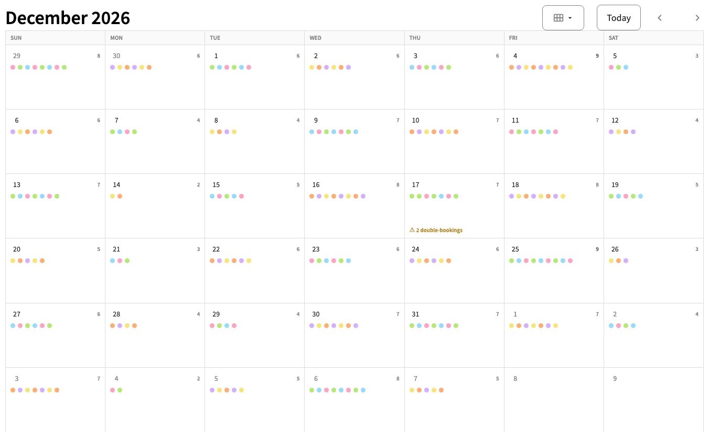
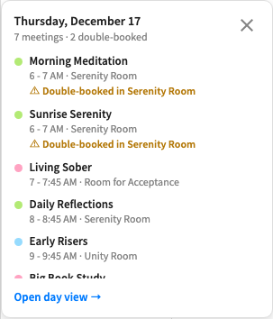

# Navigate and Filter the Calendar

## Switching views

Use the **Day / Week / Month** dropdown in the navbar to switch between a single-day layout, a
7-day week view (Sunday–Saturday), and a month view. Month view is desktop-only; on a phone the
calendar always shows the day layout.

## Moving around

- **← / →** arrows — previous/next day, week, or month
- **"Today"** — jump back to the current day, week, or month, in whichever view you're in
- **Mini calendar** (left sidebar) — click any date to jump straight to it

## Filtering

The **Filters** section in the left sidebar shows or hides meetings by category. Unchecking a box
hides that category immediately.

- **Day**, **Week**, and **Month** view each start with every filter checked, so you see everything
  by default — uncheck what you don't need. Each view keeps its own filters: unchecking a room in
  Month view doesn't hide it in Day or Week view.

Filter categories:

| Category | Options |
|---|---|
| Location | Serenity Room, Seeds of Hope Room, Unity Room, Room for Improvement, Room for Acceptance, Room for Gratitude |
| Zoom Rooms | Serenity Room - Zoom, Seeds of Hope Room - Zoom, Unity Room - Zoom, Room for Improvement - Zoom, Children's Room @ 518 - Zoom |
| Calendar | AA, Al-Anon, Other (the meeting form calls this **Meeting Type**) |
| Mode | In Person, Hybrid, Remote |

## Month view

Each day shows **one dot per meeting**, in start-time order, colored by room (the same colors as
Day and Week view; a meeting showing only through its Zoom room is grey). Hover a dot to see the
meeting's time and title. The number in a day's top-right corner is how many meetings it has, and
turns darker at 9 or more; an empty day shows no number at all.

- **Today** is circled in pink.
- The grid always shows six full weeks, so it starts and ends with a few days from the
  neighboring months. Their dates are greyed out, but their meetings are real.
- Past days look exactly like future days.

**Click any day** to open its full meeting list — every meeting's time, title, and room. From
there, **Open day view →** takes you to Day view on that date. Close the list with its ✕, by
pressing Escape, or by clicking anywhere else.

Admins also see double-bookings here — see
[the icon and badge legend](../reference/icon-and-badge-legend.md#month-view-markers).

## Overlapping meetings

In Week view, meetings that overlap in the same room share space side-by-side (up to 2 at once,
with a "+N more" indicator beyond that) rather than hiding each other — see
[calendar view behavior](../explanation/calendar-view-behavior.md#overlapping-meetings).
